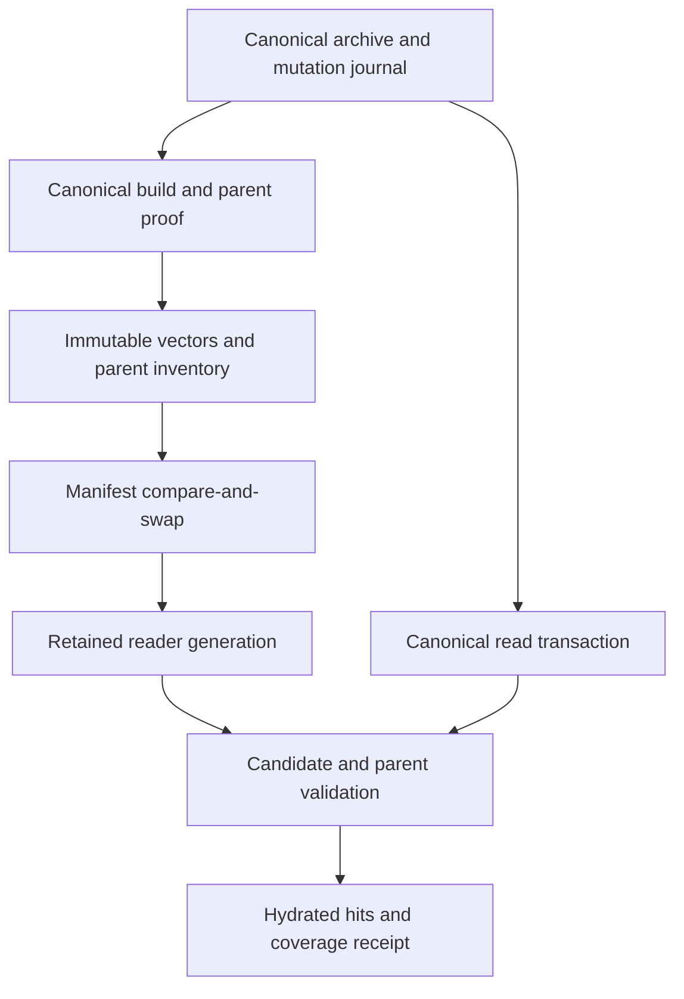

# Continuous semantic coverage — issue 458

This change extends the existing per-embedder watermarks, background maintenance,
and resumable backfill. It separates the mutable maintenance index from a
certified complete generation that a reader can retain while the archive grows.
The mutation journal is an optimization and an invalidation authority; a
watermark alone never authorizes a historical vector result.

## Serving and publication contract

The native legacy-manifest path can retain a complete generation with explicit
partial coverage. A certificate binds an immutable, digest-named FSVI file and
an immutable parent-identity inventory to an archive incarnation, committed
mutation sequence, captured maximum message ID, producer revision, and artifact
record. The existing `current.json` generation protocol, shards, external
embedders and unsupported platforms retain their strict admission rules.

Publication checks the committed archive before and after selection, inference,
and proof preparation. Caller-owned transactions cannot publish uncommitted
rows. A completed builder is sealed without replacing an existing served inode;
the document sequence must match the admitted build or the append receipt
captured under its maintenance lease. The whole legacy ledger is updated with
an expected-value comparison under its file lock. A late publisher cannot erase
another embedder's update or regress a newer boundary in the same archive.

Ordinary ingestion does not revoke a certified owner. Each query validates the
winning passage's complete semantic identity, canonical content hash, parent
proof and relevant invalidation state. Validation and result hydration use the
same canonical read transaction. Missing, changed, forgotten, reidentified or
reused messages are excluded. Hybrid fusion retains the validated semantic
payload when its score contributes to a fused result.

The cached hydration connection retains its own canonical database-file witness.
Opening seals the file and the original/canonical ancestor chains across the
read-only constructor, including connections first opened for lexical queries.
Certified reads verify pathname ownership before their transaction and after
rollback. Replacing a path cannot rebind an old connection, even when the new
database is a byte-identical copy. The opening seal detects rename-and-restore
races while stable parent symlinks remain supported. Ordinary ingestion checks
only retained identity, so WAL writes do not invalidate the owner. This is a
filesystem seal; the pinned worker API has no read-only descriptor accessor.

Parent proofs bind raw conversation/message provenance, source, workspace,
agent, timestamps used in result projection, native Codebuff/Grok identity, and
the exact raw role. Producer and query role normalization use the same helper.
Append-only tail counters do not change existing parent identities. The reader
keeps authenticated file descriptors and checks their identity/change metadata;
an appearing `current.json` selector also invalidates the legacy serving owner.

Background maintenance still uses each embedder's own watermark. A certified,
unchanged prefix can accept a tail. An interrupted append or invalidated prefix
falls back to the existing bounded canonical backfill, reusing surviving vectors
and preserving the last complete served owner. Watermark advancement and identity
repair completion compare the captured archive state rather than assigning a
newly observed live maximum after inference.

## Client coverage

New coverage-returning APIs preserve the existing semantic and hybrid wrappers.
The request's receipt is taken from its own hydration snapshot rather than a
shared mutable status field. It contains:

| Field | Meaning |
| --- | --- |
| `status` | `complete` or `partial` for the observed canonical snapshot |
| `generation` | Identity of the entire certificate, including its parent proof |
| `published_at_ms` | Generation publication time |
| `published_mutation_seq`, `current_mutation_seq` | Published and queried canonical boundaries |
| `published_max_message_id`, `current_max_message_id` | ID bounds, not message counts |
| `indexed_passages` | Passage count in the retained vector generation |
| `excluded_candidates` | Candidates rejected by this hydration attempt |
| `candidate_window_limited` | Bounded refill could leave additional candidates unexplored |
| `stale_reason` | Reason for partial coverage when present |

JSON, compact and TOON search output includes semantic coverage metadata even
without an explicit robot-metadata request. Default JSONL and sessions output
keep their data-only stdout contract and report the receipt on stderr; requested
JSONL robot metadata carries it in the metadata record. Human output reports
partial coverage. Cursor metadata carries the semantic coverage receipt.
Message ID bounds and passage counts must never be interpreted as a coverage
percentage.

The TUI carries the same request-local receipt through asynchronous completion.
Its footer keeps a partial-coverage warning visible while the displayed window
contains partial or mixed-generation pages. Stale query completions cannot
replace that status; a complete or lexical replacement clears it.

## Selection and memory

The replay inventory has independent limits: at most 128 MiB retained in the
in-memory inventory, and up to 8 GiB in the streamed disk inventory. A cold scan
writes bounded conversation frames into an atomic temporary inventory. Exact
disk hits are streamed and do not rewrite the cache. Frames, counts, order,
checksum, captured file length and exact EOF must all agree before selected
inputs escape. Late corruption discards the entire tentative selection.

When archive incarnation, physical database identity, producer and input
contracts match, a complete strictly advanced journal can merge changed, new
and deleted conversations into the old ordered inventory. Only dirty live
conversations require canonical replay; selected message text remains lazy and
checkpoint bounded. Missing, foreign, regressed, global or incompatible journal
history falls back to canonical replay. A physical archive change with an
unchanged journal sequence also remains a cold miss.

The optimization still reads the whole identity stream and rewrites it after a
journal delta. Reconciliation still holds archive-sized document-ID sets. Native
vector allocations, the active conversation, selected inputs and other caches
are outside the inventory's retained-payload budget. The limits are not a
process RSS promise.

## Fresh component measurements

The following runs used the pinned `nightly-2026-08-31` compiler and exact
production source, with dependency versions and checksums verified against the
application lockfile. The host was shared and file caches were warm. These are
component measurements, not a controlled before/after production benchmark.

| Probe | Result |
| --- | --- |
| Initial streamed persistence tests, commit `06ba065` | 12 ordinary tests passed; separate million-passage probe passed |
| Journal/header/read-bound persistence tests, commit `7e18249` | 15 ordinary tests passed; separate million-passage probe passed |
| Manifest publication/CAS tests | 7 passed, using real file locks and atomic publication |
| Parent format/prefix tests | 4 passed; separate million-record probe passed |

[Machine-readable component receipts](issue-458-component-results.json) retain
the measurements, tested source hashes, binary/receipt hashes and build profiles.
The seven manifest cases were requalified after the race-test error-propagation
change; they remain seven unique cases. Their cached compilation and execution
completed in 39.358 seconds with exit 0. No database integration is implied.

The latest replay-format probe used **1,048,576 passages in 1,024 conversations**.
Its file was **161,498,516 bytes**, larger than the previous 134,217,728-byte
retention ceiling. It retained no full memory inventory. Peak charged frame
payload was **169,008 bytes** against a 262,144-byte test frame budget. Writing
took **2.087194 seconds** and reading **1.673337 seconds**; the probe process
took 3.8865 seconds wall time and reported 17,512 KiB maximum RSS.

The earlier initial-format probe wrote/read in 1.411491/1.126467 seconds, with
15,184 KiB maximum process RSS. The later probe was slower under a different
source revision and concurrent load. Neither observation establishes a speedup.

The parent-proof probe used **1,000,001 records** in a **40,000,056-byte** file.
Authenticated admission took **104.181809 ms**, and 1,000 sparse lookups took
**26.446345 ms**. The reader's I/O buffer is 65,536 bytes. The complete separate
Cargo invocation reported 27,552 KiB maximum child RSS; that number is not an
isolated reader allocation measurement.

The persistence harness includes the real production format module and exact
enclosing declarations. The publication/proof harness compiles exact legacy
manifest, locking, filesystem, proof and test source spans. Neither substitutes
mocked verdicts, but neither compiles the complete application or exercises its
database integration. Their source integrity is checked before and after runs.

## Qualification and remaining limits

Application regressions have been added for concurrent ingestion, publication races,
uncommitted transactions, partial coverage, changed/deleted/forgotten and reused
messages, native identities, raw role changes, hybrid payload ownership, service
refresh, append receipts, replay corruption and sparse journal selection. At
this report checkpoint those full application tests and full Clippy remain
pending; the component passes above do not replace them. Full `cargo fmt --check`
passed through the original `scripts/gate.sh --verify-fmt` wrapper. The pinned
UBS v5.4.4 strict scan of 43 Rust files completed with exit 1, reporting 141
critical findings, 34,295 warnings and 12,851 informational findings. That is a
failed gate; source attribution and any follow-up fixes must remain separate
from the original result.

Native validation has reached the complete application and test sources using
the pinned compiler, unchanged lockfile, one Cargo job, disabled debug symbols
and incremental compilation, and `RUST_MIN_STACK=134217728`. The first library
check found a SHA-256 formatting incompatibility, which was corrected with the
existing hex encoder. An all-target Clippy pass then found three production
lints, which were corrected without suppressions. The next pass advanced through
the integration targets and found four errors in new library-test bindings:
one missing transaction trait import and three storage-guard dereferences.
Those are corrected, and a new all-target retry is running at this implementation
landing checkpoint. Neither a correction nor an unfinished retry is a passing
gate. A later full formatting check passed in 47.456 seconds, with scoped checks
for the subsequent small edits. Runtime tests have not yet executed. The RCH and
DSR executables are not available in this environment; this does not imply that
the project's external builders are unhealthy or unavailable elsewhere.

All 141 critical locations were recovered from the scanner's retained finding
cache and reconciled with its totals: 140 locations match baseline `aa4f5d45`
lines, and one was an explicit unexpected-error panic in the newly added
manifest race test. That test now propagates errors while preserving the
exactly-one-winner and persisted-ledger assertions. This attribution does not
turn the original scan into a passing gate or audit the unchanged code.

A final strict UBS supplement scanned the five files changed after that
43-file snapshot: the three query/coverage files, the publication coverage tests,
and the semantic manifest. It completed in 72.915 seconds with exit 1, reporting
5 critical findings, 2,733 warnings and 1,051 informational findings. Every
critical record was recovered and matched to an identical `aa4f5d45` source
location; the new manifest test's explicit panic no longer appeared. The
supplement used the unchanged gate functions, pinned runner and all 349 required
helper assets, passed the real Rust AST probe, and retained
`--ci --fail-on-warning`. Its source snapshot and live files remained unchanged
during the run. The two scan scopes overlap, so their counts must not be added.
Both strict results remain failures; this supplement neither replaces the
original result nor establishes a passing gate. Its source-manifest SHA-256 is
`71b2f28915d794125ce1a1a32d408ba2b6f5f760f568d1259cd8e43ad6b029b5`.

The robot-schema fixture generator separately reproduces baseline fixtures
before deriving additive coverage fields. Its execution and the native CLI
golden test are distinct validation scopes.

- Initial certification of a legacy tier requires one canonical verification.
  Existing background maintenance upgrades an established compatible tier
  through bounded reconciliation, reusing compatible vectors and resuming its
  checkpoint even if legacy readiness or its watermark was cleared. A prior
  watermark cannot certify a skipped prefix. Until this verification completes,
  uncertified tiers retain strict admission; certified tiers keep serving their
  previous complete generation. One-shot maintenance that saves a partial
  checkpoint cannot publish the unfinished builder as complete.
- Publication currently requires a stable captured archive interval. Continued
  ingestion can make catch-up retry; the previous certified generation remains
  available with partial coverage. A future append-tolerant publisher must first
  own one committed selection-and-parent snapshot; weakening the final file
  witness alone would be incorrect.
- The mutation journal covers supported writers and repair paths. Arbitrary SQL
  changes can bypass it and require canonical repair. Query-side parent and
  passage validation remains necessary even when a journal delta was accepted.
- A single conversation must fit the configured inventory frame limit. A cache
  refusal falls back to canonical selection rather than serving a partial cache.
- Cold admission authenticates the vector artifact and parent inventory, so its
  work is proportional to their byte lengths. A long-lived service amortizes that
  admission by retaining the verified owner; a new CLI process pays it again.
- Certified legacy owners currently use exact native vector search. The ANN
  path needs authenticated ownership of its graph and vector generation before
  it can participate in this coverage relaxation. Large-archive query latency
  needs a representative benchmark; the component measurements above do not
  establish an end-to-end search speedup.
- Native FSVI publication and parent-proof preparation still perform work
  proportional to the completed generation. This change does not implement
  vector segments, background compaction, or automatic immutable-generation GC.
- Bounded candidate refill may return fewer hits after invalidation. Its receipt
  explicitly reports when the candidate window was exhausted.
- This coverage relaxation is limited to certified native legacy-manifest
  generations on Unix. Other producer/platform/owner protocols remain strict.

Issue 458 should remain open until the native integration gates and
representative archive-scale selection/serving benchmarks are qualified.
